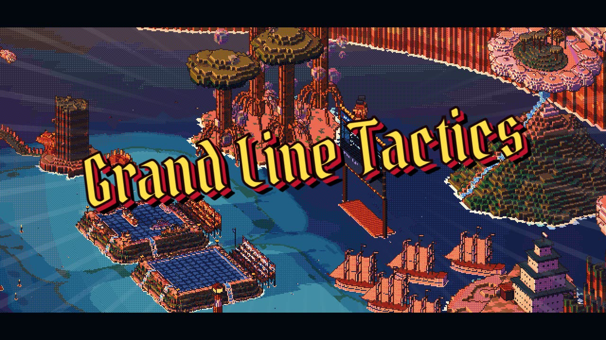
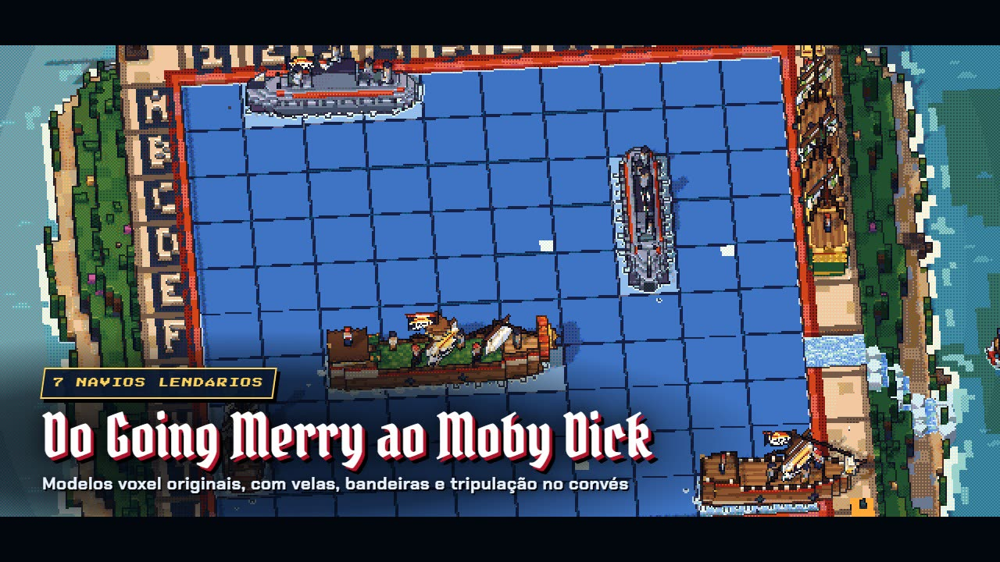
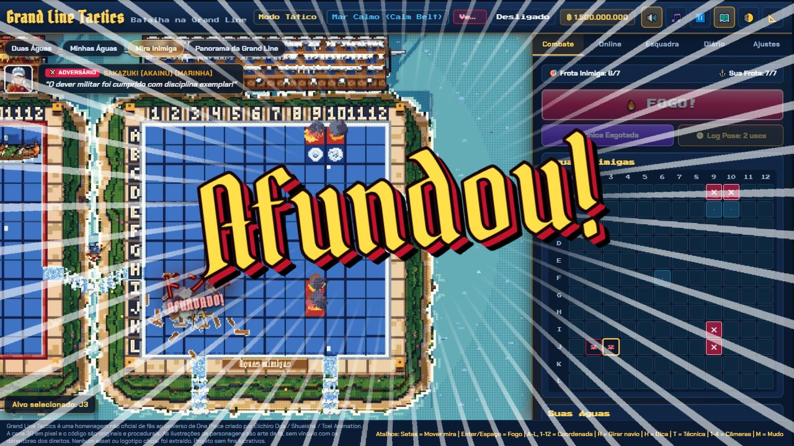
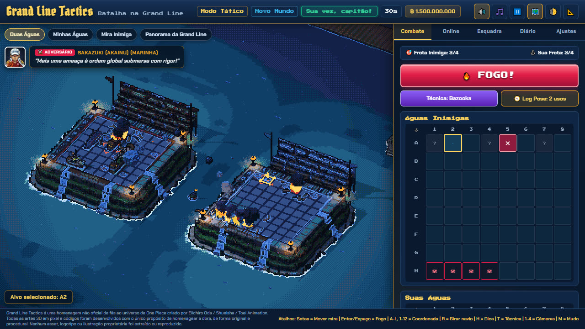
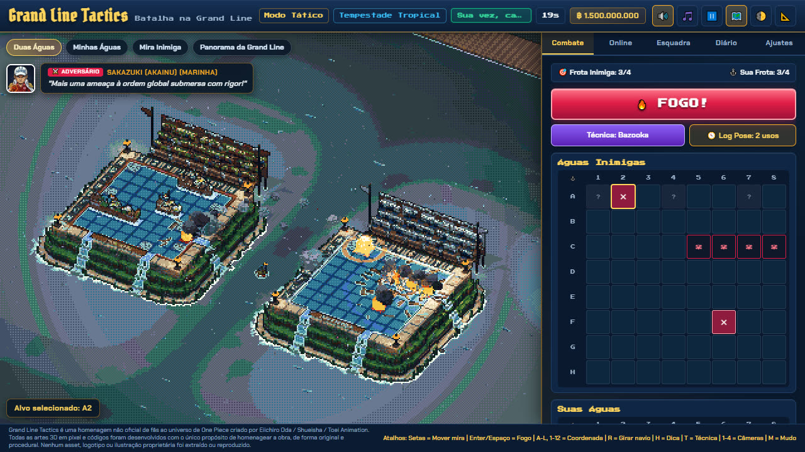
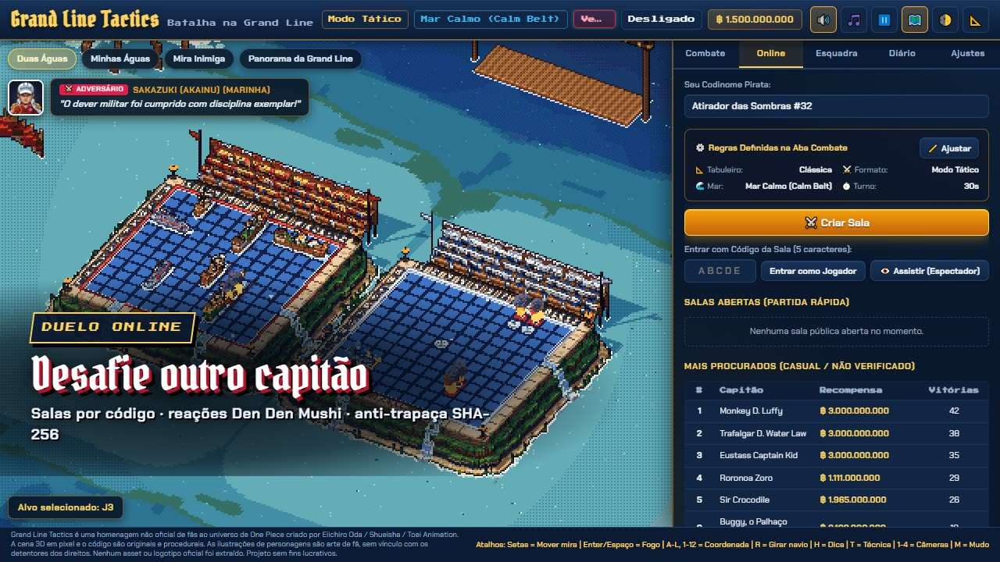
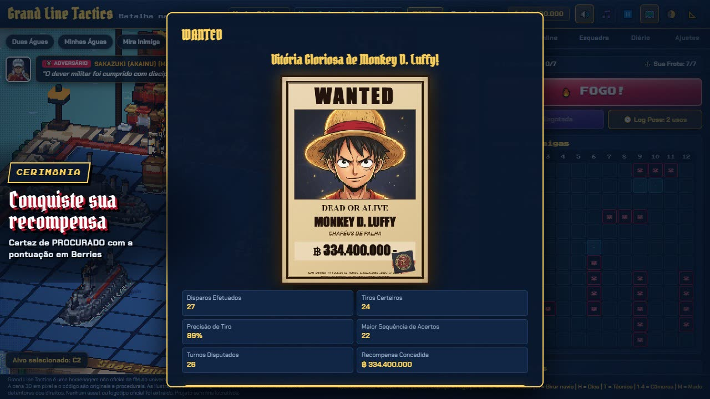

# Grand Line Tactics

**Batalha na Grand Line.** Batalha naval tática em pixel art 3D, 100% em português do Brasil. Monte sua frota com os navios lendários da Grand Line e enfrente a CPU ou outro capitão online.



> Tributo de fã não oficial e sem fins lucrativos. One Piece, seus personagens, navios e nomes pertencem a Eiichiro Oda, Shueisha e Toei Animation. Detalhes em [NOTICE.md](NOTICE.md).

---

## O jogo

| | |
|---|---|
|  |  |
| **7 navios voxel originais**: Moby Dick (5), Thousand Sunny (4), Oro Jackson (4), Red Force (3), Polar Tang (3), Baratie (3) e Going Merry (2), com velas, bandeiras e tripulação no convés. | **Combate com peso**: arco do projétil, respingo, fogo, fumaça, tábuas voando, afundamento com bolhas, cut-ins, tremor de tela e onomatopeias. |
|  |  |
| **4 mares**: Mar Calmo (dia), Grand Line (crepúsculo), Novo Mundo (noite com lanternas e farol) e Tempestade (chuva e raios). | **Cenário da Grand Line**: Red Line, Skypiea, Sabaody, Marineford, Laboon, Reis do Mar e o Big Den Den Mushi como telão. |
|  |  |
| **Duelo online** por código de sala, com reações do Den Den Mushi e anti-trapaça por commit-reveal SHA-256. | **Cerimônia de vitória** com cartaz de PROCURADO e recompensa em Berries calculada pelo seu desempenho. |

**Regras**
- 3 tabuleiros: Escaramuça 8×8 (4 navios), Clássica 10×10 (5 navios) e Grand Line 12×12 (7 navios). Séries de melhor de 1, 3 ou 5.
- 6 tripulações: Chapéus de Palha, Barba Branca, Cabelo Vermelho, Piratas do Coração, Barba Negra e Marinha.
- **Modo Tático**: uma técnica por partida para cada tripulação (Bazooka, Tremor, Haki do Rei, Room, Vórtice e Observação). **Modo Clássico**: sem técnicas e sem sorte.
- Regras opcionais: navios encostados, continuar atirando após acerto, salva, timer de turno e neblina.
- 4 níveis de CPU: Grumete, Marujo, Capitão e Yonkou (densidade de probabilidade com aprendizado de viés ao longo da série).
- Toda aleatoriedade que afeta o resultado vem de um RNG com semente (`mulberry32`), compartilhada pelos dois jogadores.

**Acessibilidade**: jogo inteiro por teclado, radar 2D em tabela semântica, anúncios `aria-live`, tema claro e escuro, `prefers-reduced-motion` e layout para celular.

---

## Como jogar

### No navegador, sem instalar nada

Abra [two2dope.github.io/grand-line-tatics](https://two2dope.github.io/grand-line-tatics/). Funciona contra a CPU e entre dois aparelhos em qualquer rede (veja "Duelo online").

**No celular, instale o jogo**: no Android, Ajustes > Aplicativo > "Instalar o jogo" (ou menu do Chrome > "Instalar app"); no iPhone, Safari > Compartilhar > "Adicionar à Tela de Início". Instalado, abre pela tela inicial sem as barras do navegador e joga contra a CPU sem internet depois da primeira visita. No navegador, o botão de tela cheia fica na barra de cima, e um celular deitado entra em tela cheia no primeiro toque (dá para desligar em Ajustes; o Safari do iPhone não tem tela cheia para páginas, só o app instalado).

Ou baixe o arquivo `grand-line-tactics.html` da [última release](../../releases/latest) e abra no navegador. Funciona contra a CPU e entre duas abas do mesmo aparelho.

### Duas pessoas na mesma rede Wi-Fi

Com Node.js 18+ instalado, rode `jogar-no-wifi.cmd` (Windows) ou:

```sh
npm run lan
```

O terminal mostra um endereço como `http://192.168.x.x:8080`. Abra esse endereço no celular ou em outro computador da mesma rede, crie uma sala em um aparelho e entre pelo outro: leia o QR Code da sala, digite o código ou toque na sala em "Salas Abertas".

O servidor entrega o three.js e as fontes a partir do próprio computador, então o segundo aparelho não precisa de internet, só do mesmo Wi-Fi. Só o aparelho que criou a sala pode excluí-la; salas abandonadas saem da lista sozinhas.

### Duelo online

Na página publicada no GitHub Pages, abra a aba Online, toque em "Criar Sala" e envie o link ou o QR Code. O outro aparelho pode estar em qualquer rede. Não há servidor do jogo: os dois navegadores se conectam direto por WebRTC, e o aparelho que criou a sala guarda o log da partida.

- A sala existe enquanto a aba do anfitrião estiver aberta. Se ele recarregar a página, retoma a sala e o convidado reconecta sozinho em alguns segundos.
- Não há lista de salas abertas nesse modo: entra-se pelo link, QR Code ou código.
- A apresentação entre os aparelhos usa o serviço público do [PeerJS](https://peerjs.com). Como em qualquer conexão direta, cada jogador vê o endereço IP do outro.
- Redes muito restritivas (algumas redes corporativas e de operadora) podem impedir a conexão direta.

O PvP também roda quando o jogo é publicado como Artifact no claude.ai, sobre as capacidades `db` (salas e log de jogadas) e `room` (presença e reações). A declaração exata está em [docs/project/PUBLISH-NOTES.md](docs/project/PUBLISH-NOTES.md). Fora desse ambiente, o modo online mostra um aviso e o jogo contra a CPU continua completo.

### Atalhos

| Tecla | Ação |
|---|---|
| Setas | Move a mira nas Águas Inimigas |
| `A`–`L`, `1`–`12` | Salta para linha ou coluna |
| `Enter` ou `Espaço` | FOGO! |
| `R` | Gira o navio na preparação |
| `T` | Usa a técnica da tripulação (Modo Tático) |
| `H` | Dica do Log Pose |
| `1`–`4` | Câmeras: Duas Águas, Minhas Águas, Mira Inimiga, Panorama |
| `M` | Liga e desliga o som |
| `Esc` | Fecha janelas ou pula a cerimônia |

---

## Desenvolvimento

Requer Node.js 18+. O `npm install` baixa só o Playwright (usado nos testes de navegador) e ativa o hook de pre-commit contra vazamentos.

```sh
npm install
npm run build             # index.html e grand-line-tactics.html (módulos concatenados, imagens externas)
npm run build:artifact    # dist/grand-line-tactics.html: arquivo único, imagens WebP embutidas (~5,4 MB)
npm run verify:artifact   # abre o arquivo isolado: zero erro de console e zero requisição fora do permitido
```

### Testes

| Comando | O que cobre | Resultado atual |
|---|---|---|
| `npm run test:rules` | Regras, RNG com semente, textos PT-BR | 46/46 |
| `npm run test:pvp` | Protocolo PvP com latência, perdas, duplicatas, refresh, desconexão e trapaça | 29/29 |
| `npm run test:artifact` | Transporte sobre `db` e `room`, com as regras de acesso aplicadas | 17/17 |
| `npm run test:ui` | Gerador de QR code e papéis de anfitrião e convidado na aba Online | 21/21 |
| `npm run test:lan:server` | Regras do servidor Wi-Fi: dono da sala, assentos, salas ociosas, nada carregado de fora | 32/32 |
| `npm run test:peer` | Regras do transporte WebRTC com um broker em memória: anfitrião como centro da sala, assentos, reconexão, fechamento | 43/43 |
| `npm run test:e2e` | Partida completa no Chrome headless: PvC, técnicas, série e PvP em duas abas | 50/50 |
| `npm run test:lan` | Servidor Wi-Fi com dois navegadores | 10/10 |
| `npm run test:lan:real` | Caminho real no Wi-Fi: convidado pelo IP da rede, link do QR Code, cliques de verdade, hosts externos bloqueados (leva alguns minutos) | 17/17 |
| `npm run test:sim` | 200.000 partidas CPU × CPU em todas as combinações; relatório em [tests/sim-report.md](tests/sim-report.md) | faixas aprovadas |

`npm test` roda as suítes unitárias, o build e os E2E. O CI do GitHub roda a checagem de vazamentos, as suítes que não precisam de navegador e, em um job separado, o caminho real no Wi-Fi com o Chrome do runner. Um push na `main` também publica o jogo no GitHub Pages (`.github/workflows/pages.yml`).

Disparos médios até a vitória no 10×10 (simulação): Grumete 95,4 · Marujo 56,1 · Capitão 47,8 · Yonkou 42,3. Primeiro jogador entre IAs iguais vence 49,1% das vezes.

### Trailer

`npm run trailer` grava o trailer de divulgação a partir do próprio jogo: captura quadro a quadro a 30 qps com tempo virtual, áudio renderizado offline nos instantes exatos de cada som e montagem em MP4 com ffmpeg. Roteiro e legendas em [tools/trailer/record.mjs](tools/trailer/record.mjs).

### Estrutura

```text
src/
  logic/        regras, IA, RNG, protocolo PvP e textos PT-BR (puro, roda no Node)
  net/          transportes: db/room do Artifact, Wi-Fi (SSE) e BroadcastChannel
  ui/           interface, fluxo de jogo, acessibilidade e app instalável (app-shell.js)
  sw/           modelo do service worker (o build gera sw.js com a lista de arquivos e a versão)
  audio/        efeitos e música sintetizados com Web Audio
  render/       renderer pixel art: paleta OKLab de 90 cores, dither Bayer, contornos, câmera
  world/        placas, oceano, cenário em anel, plateia e adereços
  ships/        modelos voxel dos 7 navios, bandeiras e frota 3D
  fx/           tiros, partículas, fogos, clima e cartaz de PROCURADO
  sea/          ponte entre o jogo e o renderer
assets/         ilustrações carregadas pelo jogo, já redimensionadas (geradas por `npm run assets`)
assets-src/     ilustrações originais em resolução cheia (não publicadas)
manifest.webmanifest  manifesto do app instalável (ícones em assets/icons, gerados por scripts/make-icons.js)
scripts/        build, build de artefato, servidor Wi-Fi, verificações e checagem de vazamentos
tests/          suítes headless, E2E, fakes de transporte e sondas de revisão visual
tools/          harness de screenshots, comparação cega, trailer e three.js vendorizado
docs/           tutorial, guias, referência, explicações, mídia e documentos do projeto
legacy/         código da primeira versão, mantido como referência
```

### Documentação

- Tutorial: [Sua primeira batalha](docs/tutorials/primeira-batalha.md)
- Guia: [Compilar, testar e publicar](docs/how-to/compilar-testar-e-publicar.md)
- Referência: [Arquitetura, regras e protocolo](docs/reference/arquitetura-regras-e-protocolo.md)
- Explicação: [Direção visual e IA](docs/explanation/direcao-visual-e-inteligencia-artificial.md)
- Contrato dos módulos de render: [ARCHITECTURE.md](ARCHITECTURE.md)
- Projeto: [especificação](docs/project/SPEC.md), [escopo da v2](docs/project/SCOPE-V2.md), [notas do port](docs/project/PORT-NOTES.md), [notas de publicação](docs/project/PUBLISH-NOTES.md) e [auditoria final](docs/project/FINAL-REPORT.md)

---

## Estado e limitações conhecidas

- O PvP online foi validado contra um fake fiel das regras de acesso, mas ainda não entre duas contas reais na plataforma.
- O PvP por WebRTC foi validado entre dois navegadores no mesmo computador, pelo serviço público de sinalização; falta validar entre redes diferentes e em celular. Não há teste automático de navegador para esse caminho.
- Os assentos são verificados por quem guarda a sala (o servidor Wi-Fi ou o navegador do anfitrião no WebRTC). No WebRTC o anfitrião é também o árbitro: um anfitrião com o jogo modificado poderia aceitar eventos falsos do próprio lado. O compromisso SHA-256 da frota continua valendo para os dois.
- 60 qps em celular e uso de memória em sessão longa ainda não foram medidos.
- Revanche na mesma sala online não funciona; é preciso criar outra sala.
- Campanha, bênçãos e perigos são cosméticos na v2: as bênçãos são relíquias de coleção e o jogo diz isso ao abrir uma.

A lista completa está na [auditoria final](docs/project/FINAL-REPORT.md) e no [CHANGELOG](CHANGELOG.md).

## Licença

Código sem licença de uso aberta: todos os direitos reservados ao autor. Os personagens, navios e nomes da série pertencem aos seus detentores. Componentes de terceiros e seus termos estão em [NOTICE.md](NOTICE.md).
